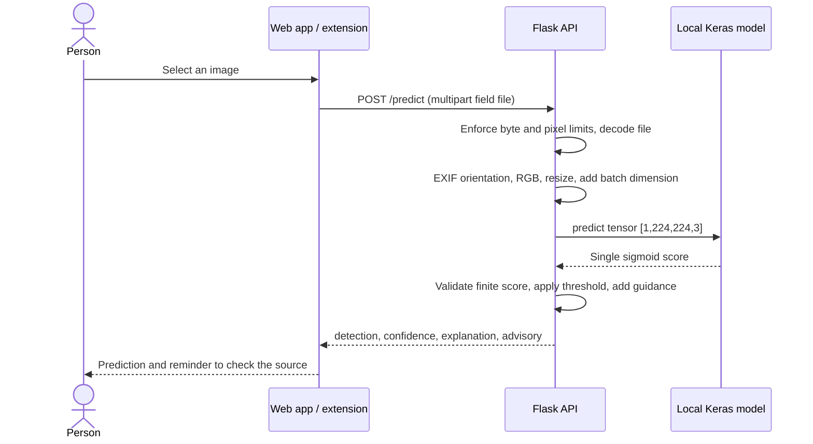

# RealReveal technical design

## Purpose and scope

Help a person pause before trusting or forwarding an image that may be AI-generated. The delivered prototype screens a single image and gives a model prediction with general source-verification guidance. It does not establish the factual truth of the accompanying claim, identify the generator or detect audio/video deepfakes.

## Architecture

```mermaid
flowchart LR
    User[User] --> Web[React and Vite web app]
    User --> Menu[Chrome image context menu]
    Menu --> Content[Extension content script]
    Content --> Worker[Extension service worker]
    Worker -->|download selected image| Website[Image host]
    Web -->|multipart file| API[Flask API on localhost:5002]
    Worker -->|multipart file| API
    API --> Validate[Decode and validate with Pillow]
    Validate --> Preprocess[RGB 224x224 float32]
    Validate -. separately enabled resized image .-> Vision[IBM-hosted vision model]
    Vision -. possible visual clues .-> Result
    Preprocess --> Model[EfficientNetB0 Keras checkpoint]
    Model --> Score[Sigmoid score and label]
    Score --> Guidance[Local verification guidance]
    Score -. optional label and score only .-> Watsonx[IBM Watsonx text model]
    Watsonx -. optional general text .-> Guidance
    Guidance --> Result[JSON response]
    Result --> Web
    Result --> Worker
    Worker --> Content
```

GitHub renders the Mermaid diagrams directly. The default flow has no cloud-model dependency. The extension performs cross-origin downloads from its worker rather than a page content script, using its declared host permissions.

## Request sequence

## Components and contracts

| Component | Responsibility |
| --- | --- |
| `frontend/src/App.jsx` | Image selection, preview, API call, result/error display; abort superseded requests |
| `backend/app.py` | Configuration, CORS, request validation, preprocessing, lazy model loading and JSON responses |
| `backend/explanations.py` | Local guidance and optional Watsonx adapter with fallback |
| `backend/attention.py` | Local Grad-CAM from the final spatial features and pre-sigmoid class score |
| `backend/vision.py` | Separately enabled IBM image-chat review, resized image encoding and explicit failure status |
| `chrome-extension/background.js` | Context menu and cross-origin image download/API requests |
| `chrome-extension/content.js` | Loading/result overlays; escape returned strings before inserting HTML |
| `training/train.py` | Train/evaluate a compatible Keras classifier on user-supplied data |

### Model contract

The deployed checkpoint accepts RGB float32 tensors of shape `(N,224,224,3)`. Raw pixel values remain in `[0,255]`; the network includes rescaling and normalization. The output is a single sigmoid value associated with the training class order `Fake=0, Real=1`.

With the default threshold, `score > 0.5` maps to `Real`, otherwise `Deepfake`. The response's legacy `confidence` field is `100*score` for `Real` or `100*(1-score)` for `Deepfake`. This is an uncalibrated model score. Changing the threshold changes classification and should be accompanied by evaluation; it does not calibrate scores.

### HTTP interface

| Endpoint | Success | Failure |
| --- | --- | --- |
| `GET /health` | 200 with process status, checkpoint existence, load state | Does not run inference |
| `POST /predict` | 200 with prediction, numeric score, guidance, advisory | 400 invalid/missing image; 413 byte/pixel limit; 415 unsupported format; 503 checkpoint load failure; 500 invalid/inference output |

### Data lifecycle and boundaries

- The API does not intentionally persist uploaded image bytes. There is no application database or upload directory.
- Multipart parsing may use operating-system temporary storage for larger files; operating-system/proxy behavior is outside application retention guarantees.
- Text-only Watsonx guidance receives the label, score and attention summary. Separately enabled IBM visual review receives a resized JPEG image, with EXIF metadata omitted, and describes possible visible clues. That review is independent of the classifier and can disagree with it.
- Debug mode is off and the development server binds to loopback by default.
- A per-process lock serializes loading and predictions. Multiple Gunicorn workers each load their own checkpoint and use additional memory.
- The Chrome extension has HTTP/HTTPS host access to fetch the explicitly selected image. It is a local demonstration and does not scan all images on a page automatically.
- CORS is an origin policy for the web client, not authentication. An internet deployment requires separate authentication, rate limiting, HTTPS, limits and operations work.

## Design choices

**Keep the existing Keras checkpoint.** It has a verified input/output shape and makes the submitted web/extension path consistent. A separate experimental PyTorch pipeline in the broader workspace is not the deployed backend.

**Lazy model loading.** Unit tests and health checks work without importing TensorFlow. Missing/corrupt weights cause an explicit 503 when inference is requested, never a simulated classification.

**Conservative guidance.** The earlier text prompt asked for visual explanations without providing the image. The delivered default instead states the model output and suggests source checks. Optional generated text is identified as general guidance.

**Generated fixtures.** Sample images are created from gradients and shapes; they avoid redistributing faces with unrecorded rights. These samples verify the application flow, not accuracy.

## Limits and evaluation plan

The checkpoint has not been independently benchmarked for general internet images or unseen generators. Record source/license, separate training/validation/test identities, and evaluate precision, recall, false-positive rate and F1 on a held-out set. Test compressed/reencoded images and generators absent from training. Evaluate calibration before interpreting scores probabilistically.

Awareness sessions, local-language content, college/NGO partnerships and public-access sustainability are future proposals, not existing deployments. No fraud reduction or community reach is claimed as measured impact.

## Explanation and upload fixes

The frontend keeps failed requests separate from classification results. HTTP errors display the server message without a class label or score. JPEG, PNG, WEBP and AVIF are decoded locally.

Grad-CAM uses the deployed EfficientNet top_activation feature map and the selected class logit. The overlay identifies influential regions; it does not prove edits. Only the label, score and attention summary are sent to optional IBM text guidance. The attention overlay remains local. With ENABLE_IBM_VISION=1, a resized image is sent to IBM Watsonx for an independent visual review. IBM chat API is used for both cloud paths.
